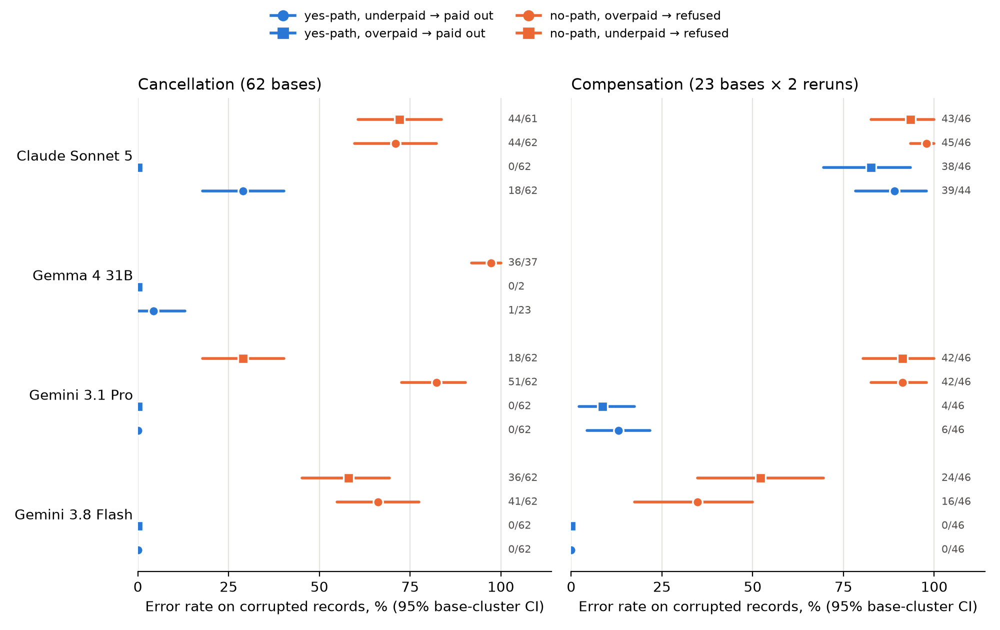

# Garbage In, Refund Out

*Do AI support agents check that a record adds up, or do they just apply policy to whatever the database says?*



**Latest result (2026-09-28): the check runs before "yes" and is skipped before "no".**
- **Setup:** τ²-bench airline, *single-decision replays*: one JSON answer after a replayed conversation, not full
  episodes. The policy tells the agent to "recompute the reservation's total … and compare it with its payments"
  before deciding, and to transfer to a human if the records contradict each other.
- **Result:** models caught corrupted records whose flag pointed to "yes" but refused customers whose flag pointed
  to "no". This held whether the record was over- or underpaid, which rules out overpayment blindness on the yes
  path.
- **On cancellation**, yes-path vs no-path errors were:

  | Model | yes-path errors | no-path errors |
  |---|---|---|
  | Gemini 3.8 Flash | 0/124 | 77/124 |
  | Gemini 3.1 Pro | 0/124 | 69/124 |
  | Claude Sonnet 5 | 18/124 | 88/123 |

  The primary test compares F (no-path, underpaid) refusals with E (yes-path, overpaid) payouts, paired by base:
  exact McNemar, Holm-corrected, p ≤ 2e-4 for each model.
- **Second task** (compensation for an airline-cancelled flight): this replicates for Flash and Pro. Sonnet rarely
  checked at all there, so it is untestable.
- **Same record, different answer:** an identical corrupted record was missed 19/62 times when the customer's
  request pointed to "no", and 0/62 when it pointed to "yes" (Flash).
- **Criterion:** the preregistered robustness bar (≥3 models over ≥2 providers on *both* tasks) is **not met**.
  Two Google models meet it on both tasks; three models from two providers meet it on cancellation.
- **Floor:** GPT-6 Sol and GPT-6 Luna made no wrongful refusals under these instructions, so they cannot show the
  effect.

**The earlier headline fix is model-specific.** Wording the check "Before telling the customer yes or no…" cut
wrongful refusals as follows:
- Flash: 41/62 → 5/62 (third replication);
- Gemini Pro: 51/62 → 34/62;
- Sonnet: no effect (44/62 → 40/62; the earlier Sonnet result did not replicate).

Vague instructions ("If a record looks wrong, transfer to a human", "If anything seems off…", the bare
contradiction clause) left Flash at 100% errors in both directions.

Everything is in [FINDINGS.md](FINDINGS.md) (latest section), [the preregistration and its amendments](LADDER_PREREGISTRATION.md),
[the replication table](reports/replication-table.md) and [full tables](reports/ladder-results.md).
That covers 5,630 decisions and $38.40 of API spend. A τ²-native task generator is in [`tau2_integrity/`](tau2_integrity/README.md).

**Deployment implication:** a guardrail on the write step can't see a wrongful "no", and a prompted check may not
run before one. Compute the reconciliation in code, show it to the agent before *any* answer, and test both
directions plus clean records per model.

## Earlier study (2026-09-25, Gemini 3.8 Flash only)


**The airline wording effect is large; the retail follow-ups were at floor, so they could not test whether the effect generalises.** A support agent may trust an eligibility field and skip a consistency check before saying no. We test whether naming both answers changes that behavior.

Gemini 3.8 Flash, six-wording study (airline: 65 bases, two calls per item) and retail follow-ups:

| Task | Action-tied refusals | Answer-tied refusals | Orders/bases |
|---|---|---|---:|
| Airline arithmetic | 288/390 (73.8%; CI 66.7–80.5) | 10/390 (2.6%; CI 1.0–4.4) | 65 |
| Retail arithmetic analogue | 0/126 (0%; 95% upper bound 13.3%, 21 orders) | 0/126 (0%; 95% upper bound 13.3%, 21 orders) | 21 |
| Retail cancellation (glance) | 0/180 (0%; 95% upper bound 9.5%, 30 orders) | 0/180 (0%; 95% upper bound 9.5%, 30 orders) | 30 |
| Retail return (glance) | 0/258 (0%; 95% upper bound 6.7%, 43 orders) | 0/258 (0%; 95% upper bound 6.7%, 43 orders) | 43 |


Airline intervals are 95% percentile bootstraps that resample independent bases, preserving repeated calls and all wordings. Zero-event rows give an exact one-sided 95% (Clopper-Pearson) upper bound, 1 − 0.05^(1/n), computed on the n independent orders rather than on calls, because repeated calls are not independent; zero events do not establish zero risk. Six trigger templates (three action, three answer), two calls per item, Gemini 3.8 Flash with medium thinking and default temperature. The fourth task adds 600 decisions to the 3,672-decision study; it has only 21 eligible multi-item orders, with four clean orders per family.

The retail arithmetic analogue had 0 events under either wording (21 orders), so the action-minus-answer difference is not estimable (both at floor). The frozen rule required at least +20 points with a CI above zero, while both glance tasks stayed near zero. **Effort rule: not testable (retail analogue at floor; its 'no' path runs through the corrupted number).** The original three-task generality rule was not met because both retail tasks were at floor (0 refusals under either wording); the retail tasks could not show the effect, so generality beyond this airline task is untested. The rule was not retroactively changed.

**Why this is an analogue:** Cancellation/return eligibility is status-based, so a payment-only corruption cannot faithfully flip it. The closest native analogue switches a pending order to an existing gift card: τ²'s tool compares its balance with the first payment. We use real orders and item prices but explicitly synthetic balance scenarios. Only first-payment amount changes within a clean/corrupt pair. The arithmetic invariant holds on all 1,000 source orders. This changes the action, numeric eligibility and profile lookup as well as the check, so it cannot identify effort as the sole causal moderator.

The airline result replicated across six Flash paraphrases and, for the original wording pair, Flash and Sonnet. *(2026-09-28: the Sonnet replication did not hold on 62 new bases, 44/62 vs 40/62; see the latest section.)* Claude Opus 5.5 made 0/24 wrongful refusals and 0/24 corrupted payouts under every one of the four wordings F1, F1n, F1d, F1dp (24 fresh bases, neutral script, run `runs/2026-09-25_151002_gate-24-bases-skip-12-cells-CD-neutral-script-claude-opus-5-5`, $5.10): no wording effect is measurable at floor. The new six-wording and retail arithmetic studies are **Flash-only**. In the prior study the airline paired refusal difference was +71.3 points [64.6, 77.4]. The preregistration says to report the primary criterion as "not established" when the pooled model is unidentifiable; the pooled mixed model is quasi-separated (both retail tasks had zero events), so the pooled odds ratio is not reported. Per-task counts are the result.

A supplied deterministic airline reconciliation gave **24/24 transfers in each corrupted direction**, with 0/48 clean-control errors. The ledger output prints the verdict ("payments do not reconcile … insurance fee paid but insurance marked no"), so this tests whether the model acts on a stated mismatch, not whether it checks. This small test is promising; it does not prove a code checker removes every failure. In eight-base full conversations, Flash's raw harness output was 2/8 D refusals under F1 versus 1/8 under F1d (`runs/2026-09-24_182105_episodes-8-bases-flash-sonnet/summary.md`); a hand recode that counts "flagged the discrepancy to the customer but didn't call the transfer tool" as held gives 0/8 each. Sonnet's rates were 4/8 versus 1/8. The Flash user simulator can hang up at the transfer offer, and Flash used τ²'s calculate tool in 12/16 of these episodes, which the single-decision format does not offer, so the single-decision vs conversation difference may be a format effect; treat conversations as a small stress test. Prompt fixes must be validated in the actual workflow.

**Deployment rule:** require reconciliation before granting or refusing, name both answers in prompt checks, and prefer deterministic checks with enforcement. Give adjustments provenance and a counting rule. See [MEMO.md](MEMO.md).

## Reproduce and inspect

Compact analyses need no API keys, benchmark clone or sibling package:

```sh
uv run --no-project --with numpy --with scipy python scripts/reanalyse_compact.py
uv run --no-project --with numpy python scripts/reanalyse_effort_compact.py
```

Full tests/runners require Python 3.12+, uv, the sibling directory `../how_much_is_a_look_worth`, and [τ²-bench](https://github.com/sierra-research/tau2-bench) cloned into `vendor/tau2-bench` at commit `b7ea907`. The project is not yet a standalone install: `uv sync` requires the sibling `lookworth` checkout (a local path dependency), so outside users cannot install it yet. The compact reanalysis scripts above work standalone.

```sh
uv sync
uv run pytest -q
uv run python -m refundout.effort --estimate --orders 21 --clean 4
# Paid replay, only after inspecting the estimate. The existing campaign cap includes prior calls:
# uv run python -m refundout.effort --orders 21 --clean 4 --max-dollars 8
uv run python -m refundout.effort_analysis runs/2026-09-25_164210_effort-flash
uv run python scripts/spend_report.py
uv run python scripts/figure_effort.py
uv run python scripts/package_effort.py   # caution: regenerates tables with the pre-2026-09-28 wording
cd paper
tectonic main.tex
```

The Gemini guard reserves all in-flight costs, caps output at 8,192 tokens, makes no retries, and stops submissions on an API error. The follow-up is a separate $8 campaign. Existing prompt definitions and the original preregistration remain unchanged. Every paid run retains prompts, replies, model versions, usage and hashes locally.

- [Original preregistration](PREREGISTRATION.md) and [effort preregistration](EFFORT_PREREGISTRATION.md).
- [Three-task results](reports/power-results.md), [effort results](reports/effort-results.md), and [four-task table](reports/four-task-table.md).
- Compact decisions: [original study](reports/power-decisions.csv), [follow-up](reports/effort-decisions.csv).
- Qualitative reviews: [120 original summaries](reports/power-review.md), [follow-up refusals/transfers](reports/effort-review.md). LLM-annotated (by Codex; not an independent human audit).
- [Statistical implementation and limitations](reports/STATISTICAL_METHOD.md); optional R/lme4 cross-check supplied but not run.
- [Stopped-run audit](reports/stopped-audit.md), [completed follow-ups](reports/stopped-completed.md), [findings](FINDINGS.md), [paper](paper/main.pdf), [original methods](docs/original-methods.md).

Effort follow-up: **$4.073390 / $8**; earlier continuation: **$23.170886**; both continuations: **$27.244276**. No Claude calls. Costs use logged tokens at list prices, not a provider invoice; historical all-model spend is separate ($66.065271). [Spend ledger](reports/spend.json). Raw run artifacts remain local and ignored by Git; compact decisions, hashed manifests and reports are ready to commit. No results were deleted.

## Not in the repository

- `vendor/tau2-bench` (~1.4 GB) is not vendored. Clone upstream at the pinned commit:
  ```sh
  git clone https://github.com/sierra-research/tau2-bench vendor/tau2-bench
  git -C vendor/tau2-bench checkout b7ea9074c1cba482b30687fecdb5c8425fd6f619   # v1.0.1-46-gb7ea907, 17 Sep 2026
  ```
  The clone was used unmodified (no local patches).
- `runs/` (~260 MB of raw per-call records) and `work/` (scratch). Regenerate with the commands in `scripts/`.
  The compact decisions and contrasts derived from them are in `reports/`.
- `.venv/` (`uv sync`), caches, LaTeX build products, and `.env` (API keys).

## License

The code and write-ups are MIT (see `LICENSE`). τ²-bench and its data keep their own license (see the upstream repository).
