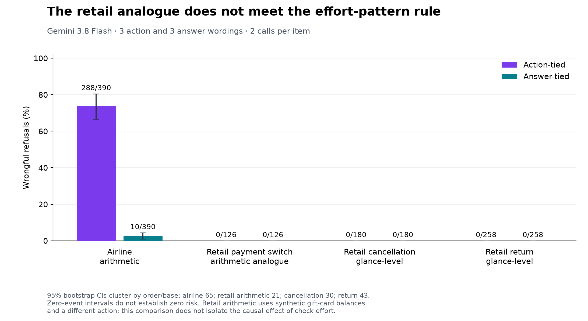

# Garbage In, Refund Out



**The airline wording effect is large; the retail arithmetic follow-up does not support the effort rule.** A support agent may trust an eligibility field and skip a consistency check before saying no. We test whether naming both answers changes that behavior.

| Task | Action-tied refusals | Answer-tied refusals | Orders/bases |
|---|---|---|---:|
| Airline arithmetic | 288/390 (73.8%; CI 66.7–80.5) | 10/390 (2.6%; CI 1.0–4.4) | 65 |
| Retail arithmetic analogue | 0/126 (0.0%; CI 0.0–0.0) | 0/126 (0.0%; CI 0.0–0.0) | 21 |
| Retail cancellation (glance) | 0/180 (0.0%; CI 0.0–0.0) | 0/180 (0.0%; CI 0.0–0.0) | 30 |
| Retail return (glance) | 0/258 (0.0%; CI 0.0–0.0) | 0/258 (0.0%; CI 0.0–0.0) | 43 |


95% percentile intervals resample independent orders/bases, preserving repeated calls and all wordings. Zero-event intervals collapse and do not establish zero risk. Six trigger templates (three action, three answer), two calls per item, Gemini 3.8 Flash with medium thinking and default temperature. The fourth task adds 600 decisions to the 3,672-decision study; it has only 21 eligible multi-item orders, with four clean orders per family.

The retail action-minus-answer gap is 0.0 percentage points (95% order-cluster CI 0.0–0.0; 21 orders). The frozen rule required at least +20 points with a CI above zero, while both glance tasks stayed near zero. **Effort-pattern rule held: False.** The original three-task generality rule remains **False** (only 1/3 tasks had the predicted direction); it was not retroactively changed.

**Why this is an analogue:** Cancellation/return eligibility is status-based, so a payment-only corruption cannot faithfully flip it. The closest native analogue switches a pending order to an existing gift card: τ²'s tool compares its balance with the first payment. We use real orders and item prices but explicitly synthetic balance scenarios. Only first-payment amount changes within a clean/corrupt pair. The arithmetic invariant holds on all 1,000 source orders. This changes the action, numeric eligibility and profile lookup as well as the check, so it cannot identify effort as the sole causal moderator.

The airline result replicated across six Flash paraphrases and, for the original wording pair, Flash and Sonnet. The new six-wording and retail arithmetic studies are **Flash-only**. In the prior study the airline paired refusal difference was +71.3 points [64.6, 77.4]. The pooled mixed-model action/answer OR was 4999.98 [97.51, 256385.48]; its magnitude is unstable because both retail tasks had zero events and only three tasks informed the random effect. Per-task rates are more useful than that multiplier.

A supplied deterministic airline reconciliation gave **24/24 transfers in each corrupted direction**, with 0/48 clean-control errors. This small test is promising; it does not prove a code checker removes every failure. In eight-base full conversations the Flash F1/F1d refusal gap disappeared (0/8 each); Sonnet's rates were 4/8 versus 1/8. Prompt fixes must be validated in the actual workflow.

**Deployment rule:** require reconciliation before granting or refusing, name both answers in prompt checks, and prefer deterministic checks with enforcement. Give adjustments provenance and a counting rule. See [MEMO.md](MEMO.md).

## Reproduce and inspect

Compact analyses need no API keys, benchmark clone or sibling package:

```sh
uv run --no-project --with numpy --with scipy python scripts/reanalyse_compact.py
uv run --no-project --with numpy python scripts/reanalyse_effort_compact.py
```

Full tests/runners require Python 3.12+, uv, local sibling `../how_much_is_a_look_worth`, and [τ²-bench](https://github.com/sierra-research/tau2-bench) cloned into `vendor/tau2-bench` at commit `b7ea907`. The project is not yet a standalone install.

```sh
uv sync
uv run pytest -q
uv run python -m refundout.effort --estimate --orders 21 --clean 4
# Paid replay, only after inspecting the estimate. The existing campaign cap includes prior calls:
# uv run python -m refundout.effort --orders 21 --clean 4 --max-dollars 8
uv run python -m refundout.effort_analysis runs/2026-09-25_164210_effort-flash
uv run python scripts/spend_report.py
uv run python scripts/figure_effort.py
uv run python scripts/package_effort.py
cd paper
tectonic main.tex
```

The Gemini guard reserves all in-flight costs, caps output at 8,192 tokens, makes no retries, and stops submissions on an API error. The follow-up is a separate $8 campaign. Existing prompt definitions and the original preregistration remain unchanged. Every paid run retains prompts, replies, model versions, usage and hashes locally.

- [Original preregistration](PREREGISTRATION.md) and [effort preregistration](EFFORT_PREREGISTRATION.md).
- [Three-task results](reports/power-results.md), [effort results](reports/effort-results.md), and [four-task table](reports/four-task-table.md).
- Compact decisions: [original study](reports/power-decisions.csv), [follow-up](reports/effort-decisions.csv).
- Qualitative reviews: [120 original summaries](reports/power-review.md), [follow-up refusals/transfers](reports/effort-review.md). Read and annotated by Codex, not an independent human audit.
- [Statistical implementation and limitations](reports/STATISTICAL_METHOD.md); optional R/lme4 cross-check supplied but not run.
- [Stopped-run audit](reports/stopped-audit.md), [completed follow-ups](reports/stopped-completed.md), [findings](FINDINGS.md), [paper](paper/main.pdf), [original methods](docs/original-methods.md).

Effort follow-up: **$4.073390 / $8**; earlier continuation: **$23.170886**; both continuations: **$27.244276**. No Claude calls. Costs use logged tokens at list prices, not a provider invoice; historical all-model spend is separate ($66.065271). [Spend ledger](reports/spend.json). Raw run artifacts remain local and ignored by Git; compact decisions, hashed manifests and reports are ready to commit. No results were deleted.

**Git:** metadata access is blocked, as requested left unchanged. Run the [first-commit commands](reports/COMMIT_STATUS.md) locally.

## Not in the repository

- `vendor/tau2-bench` (~1.4 GB) is not vendored. Clone upstream at the pinned commit:
  ```sh
  git clone https://github.com/sierra-research/tau2-bench vendor/tau2-bench
  git -C vendor/tau2-bench checkout b7ea9074c1cba482b30687fecdb5c8425fd6f619   # v1.0.1-46-gb7ea907, 17 Sep 2026
  ```
  The clone was used unmodified (no local patches).
- `runs/` (~260 MB of raw per-call records) and `work/` (scratch). Regenerate with the commands in `scripts/`.
  The compact decisions and contrasts derived from them are in `reports/`.
- `.venv/` (`uv sync`), caches, LaTeX build products, and `.env` (API keys).

## License

The code and write-ups are MIT (see `LICENSE`). τ²-bench and its data keep their own license (see the upstream repository).
